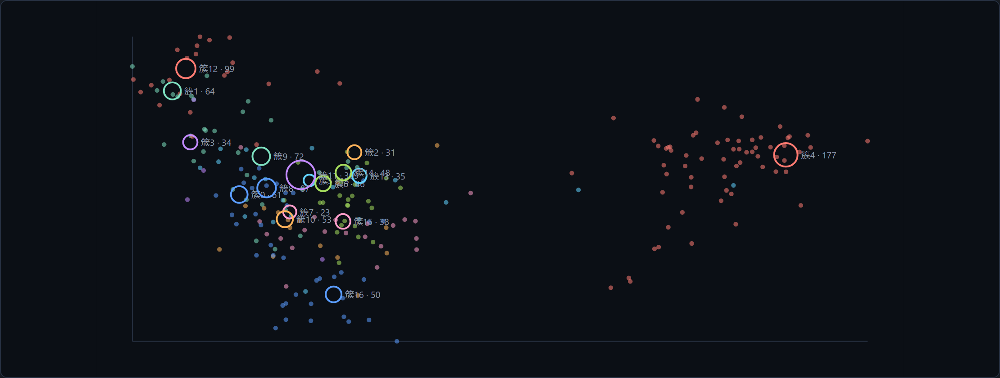
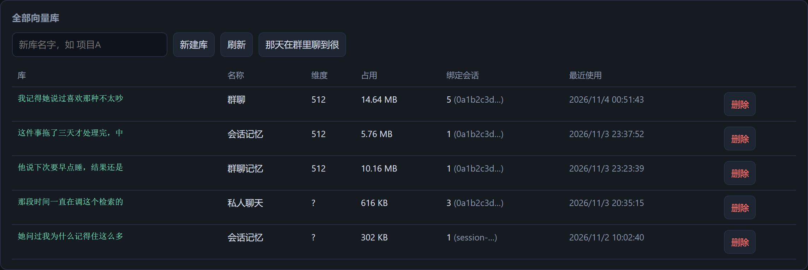
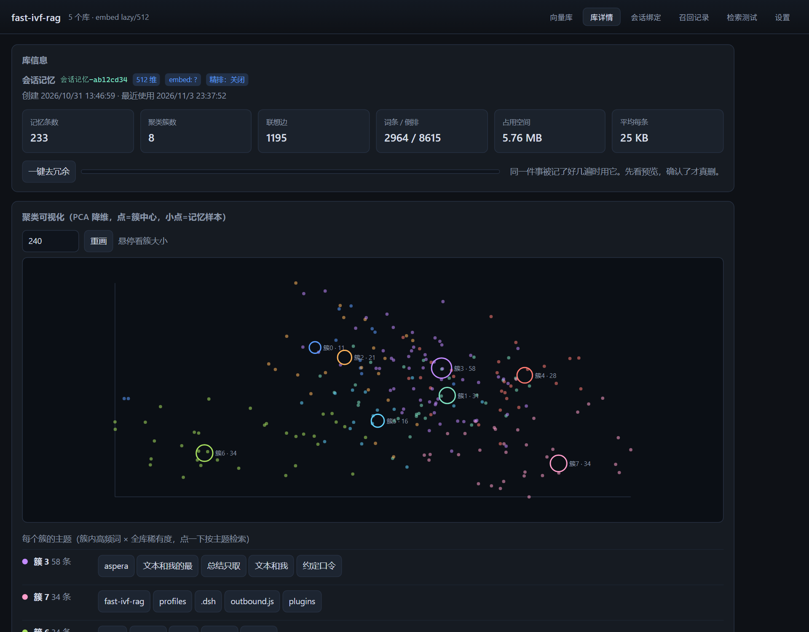
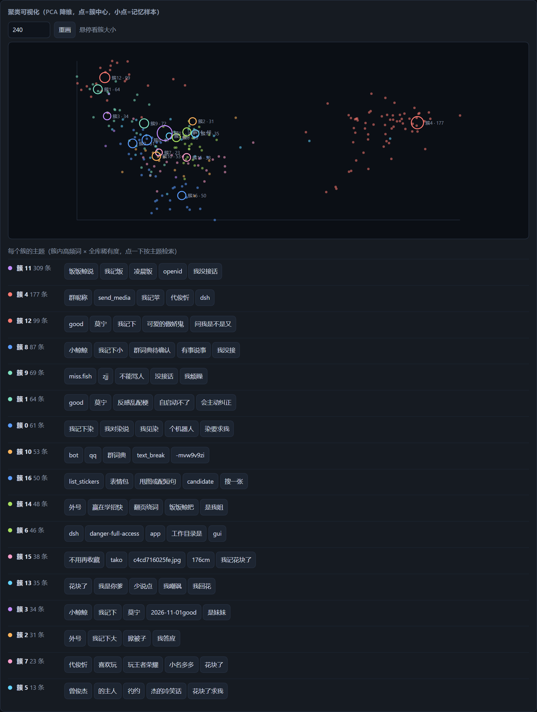
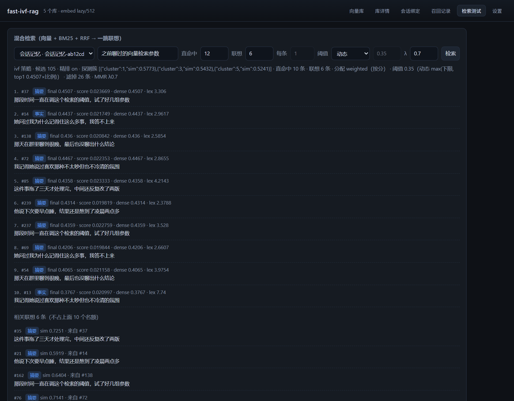
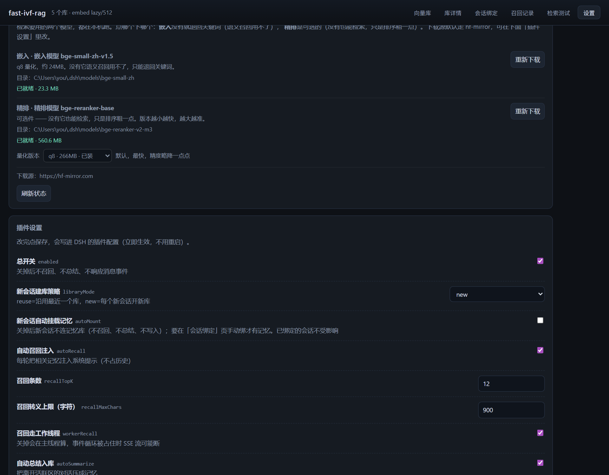

# fast-ivf-rag

给 [DeepSeek Harness](https://github.com/deepseek-ai/dsh) 加一层**跨会话的长期记忆**。

本地 bge-small-zh 向量 + IVF 聚类粗筛 + BM25 关键词 + RRF 融合 + 可选 cross-encoder 精排，全部落在 sqlite 里。不联网、不上报、不调 LLM（除非你在跑总结）。



---

## 它能干什么

| 能力 | 说明 |
| --- | --- |
| **记住** | `rag_add` / `rag_edit` 写记忆；自动总结把离开活跃区的对话压成第一人称短句，一条一句 |
| **自动想起** | 每轮用户消息进来先检索一次，命中的记忆作为**上下文**注入（不占历史、不改写会话） |
| **主动去查** | `rag_search` 是个普通工具，Agent 想翻旧账时随时调；检索够快，调用不会卡住回复 |
| **分库** | 一个会话绑一个库，群聊、私聊、不同项目各自独立，互不污染 |
| **看得见** | 面板里有聚类散点、簇主题、召回记录、检索测试，全部可点开、可改、可删 |

工具：`rag_add` / `rag_edit` / `rag_search` / `rag_libraries` / `rag_stats` / `rag_recent` / `rag_use` / `rag_forget` / `rag_summarize`。

### 为什么要它

**会话是有寿命的，记忆不该跟着一起死。**

DSH 的会话被压缩、被换掉之后，几十轮之前聊过的事就只剩一句摘要——何况摘要本身也在被压缩。你要么把上下文撑得很长（贵、慢、还会被截断），要么接受「聊过就忘」。

一个专门的记忆库把这两件事分开：**会话负责当下，库负责过去**。库里的东西不占上下文，需要的时候按语义捞出来，每条几十字。

但「捞得准」只是半个问题，另半个是**捞得快**——如果每次召回都要扫一遍全库、跑一遍重排，它就会变成会话的瓶颈，你最后还是会关掉它。所以下面大半篇幅在讲：**为什么它能在几毫秒内给出结果**。

### 两种用法：它自己想起来，或者它主动去查

记忆库不只是「每轮悄悄塞几条」，它有两条完全不同的入口：

**① 自动召回（被动）** —— 每轮用户消息进来，插件先检索一次，命中的记忆作为 `runtime-context` 注入到这条消息**之前**。它不占会话历史、不进 system、不参与压缩，长度由 `recallMaxChars`（默认 900）卡死。这条路的优点是「不用问就看见了」，代价是**每轮都跑一次**——所以它必须便宜。

**② 工具调用（主动）** —— `rag_search` 是一个普通工具，和 `read`、`bash` 摆在一起。Agent 觉得该翻旧账的时候自己调：

- 用户问「上次那个」「你还记得吗」「我之前说过什么」；
- 要引用一个以前得出的结论、或者确认某个决定是什么时候做的；
- 写日记、写总结之前，先把这一段相关的事捞出来。

这条路的优点是**精准**——可以把 `topK`、`assoc`、`assocMode`、`minScoreMode` 都按这次查询调；自动召回只能用一套全局默认值。

**为什么工具这条路成立**：因为检索够快。热路径 **6~8 ms**，主线程最多被占 **2 ms**——一次 `rag_search` 在时间上和读一个小文件同量级，**调用它不会让回复卡住**。如果它是 300 ms 起步，模型每想查一次就要停顿三百毫秒，那种工具你会本能地不用它；能用，是因为它便宜到「随便查」。

> 这也是为什么召回要丢到子进程里跑：不是为了省那 6 ms，是为了让主线程不被 ONNX 抓住。工具调用是同步等待的，主线程一卡，整轮回复就跟着卡。

---

## 界面

### 库列表



一个库一个 sqlite 文件，各自标着维度、占用、绑定了几个会话。

### 库详情



记忆条数、聚类簇数、联想边、词条/倒排、占用空间，一眼能看到这个库「长得怎么样」。

### 聚类可视化与簇主题



图下面那一排是**每个簇的主题**——取簇内高频词 × 全库稀有度算出来的，点一下就能按这个主题去检索。调聚类效果的时候主要看这个：同一簇里的词要是彼此不搭，说明簇分得不对，要么加簇数要么加数据。

### 检索测试



每次检索都会把**中间过程**摊开：ivf 策略用了几个候选、探了哪几个簇（带相似度）、RRF 之后几条过阈值、丢掉几条、联想分配模式、最终阈值算成了多少。调参的时候看这一行比看结果有用。

### 设置



模型状态、量化版本、下载源，以及所有行为开关。改完即时生效（除了 `dataDir` / `embedModelDir`）。

---

## 它是怎么快的

这一节是重点。检索的主链路只有几十行，但每一段都在削成本。

### 一、先分区：mini-batch k-means + IVF

**问题**：库里 1000 条记忆，来一个问题要算 1000 次 512 维点积。10000 条就是 10000 次。这是 `O(N·d)`，随库线性增长——而记忆库只会越来越大。

**做法**：先把所有记忆按语义聚成簇，检索时**只探最像的几个簇**。这是倒排文件（IVF）的标准套路，只不过这里的分区器是手写的球面 k-means。

```js
k = clamp(round(√n / 2), 2, 512)     // 746 条 → 8 个簇
```

簇数取 `√n/2` 而不是 `√n`：粗筛只要「大致分开」，簇多一点反而探不完。

几个刻意的地方：

- **球面 k-means**：向量进来就 L2 归一化，于是「点积 = 余弦」，省掉每次算模长。簇心同样是归一化后的均值方向。
- **kmeans++ 初始化**（用 `1 - 相似度` 当距离加权抽点），比随机初始化稳，不容易出现空簇。
- **固定 10 轮 + `seed=42`**：粗筛不需要极致精度，要的是可复现——同一个库重画两次聚类图应该长得一样。
- **空簇处理**：某轮出现空簇就抢一个随机点重生，避免死簇。

**增量入簇**（对应 `MiniBatchKMeans.partial_fit`）：新记忆写进来**不等全量重建**，直接按余弦 argmax 找到最近的簇，然后把簇心往它那边挪一点（滑动平均），同时连 5 条邻居边。只有每写满 `rebuildEvery`（默认 50）条才全量重聚一次。

**提速在哪**：候选集从 `N` 降到「探 3 个簇的成员数」。截图里那个库 233 条、8 簇，探 3 个簇之后候选只有 **105 条**——后面所有计算（余弦、BM25 打分、RRF、精排）都只在这 105 条上跑，而不是全库。

> 探簇数 `probe`（默认 3）是**召回率与速度的旋钮**。探 1 个最快但可能漏；探全部就是暴力检索。3 是个经验值，因为簇心是按 `√n/2` 分的，3 个簇通常已经覆盖 query 附近的大半空间。

### 二、两条腿走路：向量 + BM25

**问题**：纯向量检索抓不住「原样词」。查 `dsh-context-ctl`、`outbound.js`、`MRR` 这种专有名词时，语义模型会给你一堆「意思相近但完全不是这个东西」的结果。

**做法**：同时跑一路 BM25，两路各排一次序再融合。

BM25 这一路是自己搭的倒排表，不是 SQLite 的 FTS5——**FTS5 的 trigram 分词只匹配三字以上，中文两字词（"召回""向量""聚类"）根本检索不到**。所以这里自己分词（CJK 单字 + 双字 bigram + 拉丁词）、自己算 TF/IDF、自己存 posting 表。

**提速在哪**：BM25 这一步也在**候选集内**做，不是全库扫。倒排表只用来找 posting，交集也只算候选里的。

### 三、融合用 RRF，不用加权求和

**问题**：余弦分是 `[-1, 1]`，BM25 分是 `[0, 30+]`，量纲差了两个数量级。加权求和得先归一化，而归一化方式又会随着数据分布漂移——今天调好的权重，下周就不好使了。

**做法**：Reciprocal Rank Fusion，**只看排名，不看分数**。

```
score(d) = Σ_paths 1 / (k + rank_path(d))      // k = 60
```

好处是零参数、两路天然可比。某一路的绝对分值怎么飘都无所谓，只要它排得出来。

**提速在哪**：融合只做加减法，比调权重的方案少一遍归一化；更重要的是**它容忍粗排**——因为排名比分数稳，前面 IVF 粗筛和 BM25 的粗糙不会在融合这一步被放大。

### 四、精排之前先「缩句」

**问题**：cross-encoder 是唯一真正「读懂 query 和 doc」的一步，也是最贵的一步——`O(候选数 × 序列长度)`。一条记忆 800 字，送进去 24 条，光注意力就是几百万次。

**做法**：送精排之前，先把长记忆**按查询压短**（对应原项目的 `CONDENSE_BEFORE_RERANK`）：

```
把记忆按 。！？；，、 切成从句
保留「命中 ≥2 个查询词」或「命中 1 个且带情感词」的从句
按原序拼回去，上限 condenseMaxLen（默认 160 字）
如果一个都没命中 → 退回截断，绝不返回空串
```

「带情感词」这条是专门为聊天记忆加的：「喜欢 / 讨厌 / 烦 / 生气 / 开心 / 舍不得」这类词本身就说明这个从句有信息量，哪怕只命中一个查询词也该留。

**提速在哪**：序列长度从几百降到 160 以内，精排的算力大致**跟着序列长度线性下降**；同时短文本的 cross-encoder 判断也更准——长文里一堆无关从句会稀释真正的相关片段。

### 五、多样性：MMR

**问题**：topK 里五条都在说同一件事。语义上它们确实都相关，但对「回忆」没用——你想知道的是一个完整的故事，不是同一句话的五个说法。

**做法**：Maximal Marginal Relevance。

```
score(i) = λ · relevance(i) − (1−λ) · max_{j ∈ 已选} sim(i, j)
```

每选一条，下一轮就用它去惩罚和它相似的候选。`mmrLambda` 默认 0.7（0 = 关闭）。

两个细节：

- **先过阈值，再 MMR**。阈值管「够不够相关」，MMR 管「够不够不同」，两件事分开做，省得互相干扰。
- **挡住零相关的**。MMR 对「跟谁都不像」的候选惩罚是 0，λ 一低就会把驴唇不对马嘴的条目捞上来。所以进 MMR 之前先剔掉 `final <= 0`。

**提速在哪**：MMR 只在**已经过阈值的那一小撮**上做（不是全候选），而且它同时压缩了送进上下文的条数——5 条重复的记忆和 1 条，占的 token 差 5 倍。

### 六、动态阈值

**问题**：固定阈值 `0.35` 在两种情况下都是错的。话题近的时候，0.4 分的垃圾也会被捞进来；话题远的时候，真正相关的那条只有 0.3，被一刀切掉。

**做法**：阈值**跟着这次查询自己的最高分走**。

```
threshold = max(minScoreFloor, top1 × minScoreRatio)      // 默认 max(0.35, top1 × 0.55)
```

查得到就收紧（top1 高 → 阈值高），查不到就放宽（top1 低 → 落回下限）。比一个死数字更能抗话题漂移。

低于阈值的一律丢掉：**不占 topK 名额、不给联想配额、不进提示注入**——宁可少几条，也别污染认知。

### 七、一跳邻居联想

**问题**：有些相关性不在语义里，而在「它们是一起被聊到的」。问「上次那个插件的 bug」，语义上最像的是「这个插件有个 bug」这条，但真正有用的是紧挨着它的「后来怎么修的」。

**做法**：写入时给每条记忆连 **5 条最近邻边**（在簇内采样算，不用全库）。检索命中之后，顺着边把邻居也带出来。

联想层是**完全独立的一层**：

- **不占 topK 名额**——直命中 12 条就是 12 条，联想另算；
- **不参与打分排序**——它带 `sim`（边相似度）和 `from`（从哪条来的），在旁边单独列；
- **配额分配有两种**：`weighted`（默认，按直命中的终分归一化分名额，分高的多联想）和 `even`（每条均分）。某条边不够就把它空出来的名额让给下一轮，最多 8 轮。

**提速在哪**：边表是**预先算好的**（写入时连，不是检索时算），取邻居是一次 `edgesOf()` 查询，O(1) 级别的 SQL。用几十微秒换来「语义检索够不着但确实相关」的那部分，很划算。

### 八、写入时就去重

**问题**：摘要由 LLM 重写，同一件事换个说法 hash 就变了。库里堆成好几条，检索时一起被翻出来——既浪费 topK 名额，又让 MMR 以为「有五个独立证据」。

**做法**：两道去重。

1. **文本 hash**：逐字相同，直接挡掉；
2. **语义去重**：`dedupeThreshold`（默认 0.92）。先用簇心粗筛出最像的 3 个簇，只在簇成员里算精确余弦——**复用 IVF，不额外全库扫**。

批内也要查（一次总结 24 条，前三条可能就是同一件事），所以既比库里的也比本批已收下的。

**提速在哪**：去重本该是 `O(N)` 的全库比对，靠「簇心粗筛 + 簇内精确」压成了「3 个簇」。

---

## 速度账

同一条查询，同一个库（1000 条量级、512 维）：

| 环节 | 全量暴力 | 本插件（IVF + 缩句 + worker） |
| --- | --- | --- |
| 候选集 | 全库 1000+ | 探 3 簇 ≈ 100~200 |
| 向量余弦 | O(N·d) | O(候选·d) |
| BM25 | 全库倒排 | 候选内 |
| 精排输入长度 | 原文（几百字） | condense 后 ≤160 字 |
| MMR | 全候选 | 过阈值的一小撮 |

实测（本机，bge-small-zh 512 维，真实库）：

| 场景 | 耗时 |
| --- | --- |
| 冷启动首次召回（含子进程启动 + 模型加载） | ~349 ms |
| **热路径召回（含精排）** | **6~8 ms** |
| 主线程最大卡顿 | **2 ms** |
| 改造前：同一条召回跑在主线程 | 341 ms |

那 341ms 不是「慢一点」的问题——它正好落在宿主 SSE 流等 socket 的窗口里，足以被 `dsh-llm-deepseek` 判成 transport 错误。所以召回**跑在独立子进程**里：主线程一次 ONNX 都不碰，自己 2ms 内交还事件循环。

> 同一个进程里两份 onnxruntime 会话会把宿主打死（`v8::HandleScope::CreateHandle` / API version 不匹配）。先试过 `worker_threads`，不行——它仍在同一个 V8 进程里。所以用 `child_process.fork`：独立 V8，ORT 崩也只崩它自己，主进程照常。

**这个数字决定了它能是什么**。300 ms 的检索只能当「后台任务」，你不敢在对话中途调它；**6~8 ms 的检索可以当工具**——模型想查就查，查完接着说话，人感觉不到中间停顿过。同一个算法，慢一个数量级就只是「有个记忆库」，快到这个量级才敢让智能体自己决定什么时候用。

---

## 为什么这套东西换来「长时间的记忆保持」

把上面几条串起来看：

```
快 → 每轮都能召回（自动），也能随时被当工具调（主动），不用攒、不用等、不用用户主动问
便宜 → 召回进的是 runtime-context（900 字符封顶），不占会话历史、不进 system
短 → 「库里几百条」在上下文里只表现为「这一轮相关的 5 条、每条几十字」
```

于是原来那个二选一被绕开了：

| 做法 | 代价 |
| --- | --- |
| 把上下文撑长 | 每轮都付全额的 token，还得防压缩、防换会话 |
| 聊完就忘 | 没有记忆，每次都得重新解释 |
| **会话 + 记忆库** | 会话只负责当下，过去交给库按需取用 |

**会话可以短，记忆可以长。** 这就是它存在的理由——不是为了「有个向量库很酷」，是为了让你在同一个群里聊三个月之后，它还认得你上周说过什么，而且**不用为此每轮多付一分钱**。

顺带一提：它和 [dsh-context-ctl](https://github.com/Mrapple051108/DSH-Context-Control) 是配套的。那个负责把会话历史裁短，这个负责在裁短之后仍然捞得回旧事。两个一起开，会话长度和记忆长度就彻底解耦了。

---

## 用法

### 模型（可选，不装也能用）

| 模型 | 作用 | 不装会怎样 |
| --- | --- | --- |
| `bge-small-zh-v1.5`（嵌入，~24MB） | 把文本变成 512 维向量 | 退化成字面量哈希嵌入，检索变成纯字面匹配 |
| `bge-reranker-*`（精排，可选） | cross-encoder 重排候选 | 走 RRF 排序，速度更快、精度略降 |

面板「本地模型」那块能直接下（下载源默认 `hf-mirror.com`），选量化版本 → 点下载 → 进度条走完。精排模型有 q8 / fp16 / fp32 / q4f16 / q4 五个版本，**选的版本要和加载时的 dtype 对上**，否则下完了起不来。

精排模型目录的自动发现规则：扫 `~/.dsh/models/`，名字里带 `rerank` 且同时有 `config.json` + `tokenizer.json` + 某个 `.onnx` 的目录即被采用。

> reranker 是**单标签**模型（`id2label` 只有 `LABEL_0`），transformers.js 的 `pipeline("text-classification")` 会对 1 个 logit 做 softmax、永远输出 1.0。所以这里直接跑 `AutoModelForSequenceClassification`，读原始 logits 自己过 sigmoid。

### 主要配置

| 字段 | 作用 |
| --- | --- |
| `libraryMode` | `reuse` 新会话沿用上一个库，`new` 每个新会话开新库 |
| `autoRecall` / `recallTopK` / `recallMaxChars` | 自动召回开关 / 条数 / 注入字符上限 |
| `autoSummarize` / `activeWindow` / `summarizeMinMessages` | 自动总结开关 / 活跃区条数 / 最少积压条数 |
| `useAssociation` / `recallAssocCount` / `assocMode` | 一跳联想开关 / 名额 / 分配方式 |
| `rerankEnabled` / `rerankTopN` / `condenseMaxLen` | 精排开关 / 送排候选数 / 缩句上限 |
| `rebuildEvery` / `probe` / `maxK` | 每 N 条全量重聚类 / 探簇数 / 簇数上限 |
| `mmrLambda` / `minScoreMode` / `minScoreFloor` / `minScoreRatio` | 多样性 λ / 阈值模式 / 下限 / 占比 |
| `dedupeThreshold` | 语义去重阈值（0 = 关） |
| `workerRecall` | 召回 / 嵌入 / 精排是否丢到子进程（**强烈建议开**） |

改完即时生效；`dataDir` / `embedModelDir` 要重启。

### 数据

```
~/.dsh/fast-ivf-rag/
  index.sqlite              库登记 + 会话绑定
  libraries/<id>.sqlite     一个库一个文件：mem / cluster / edge / posting / docstat
~/.dsh/models/bge-small-zh/ 嵌入模型
```

---

## 结构

```
lib/kmeans.js       球形 k-means（kmeans++ 初始化、空簇重生、固定 seed）
lib/tokenize.js     中文分词（单字 + 双字 + 拉丁词）
lib/embed.js        bge-small-zh 嵌入（+ 词法降级）
lib/condense.js     精排前按查询把长记忆切成相关短句
lib/rerank.js       可选 cross-encoder 精排（含模型自检）
lib/store.js        node:sqlite 封装（IndexDb / LibraryDb）
lib/library.js      单库：写入 / 增量入簇 / 聚类 / BM25 / RRF / 精排 / 检索 / 可视化
lib/manager.js      多库管理 + 会话绑定 + 运行期改配置
lib/summarize.js    总结 prompt 与解析（第一人称 + 日期归一）
lib/recall-worker.js 子进程入口：嵌入 / 检索 / 精排都在这里跑
lib/recall-pool.js   子进程客户端（懒启动、20s 超时、崩了重起、空闲 unref）
lib/index.js        DSH 插件入口（工具 / 提示段 / HTTP 面板）
ui/index.html       面板前端（无依赖）
```

测试：

```bash
node test/grounding.test.mjs
node test/model-fetch.test.mjs
```

## 已知边界

- **IVF 是近似检索**。探簇数太小会漏召回，`probe` 调大换召回率。
- **簇数上限 512**。库里几万条以上时，`√n/2` 会撞上限，粗筛粒度变粗。
- **精排是线性的**。`rerankTopN` 开太大会拖慢热路径，20~24 是甜点。
- **嵌入模型换掉要重算**。库里存的是旧模型的向量，换了模型语义空间对不上；插件能识别 `embed_kind` 不一致并退回词法通道，但最好重建。
- **去重阈值太高会漏**（同一件事换个说法没挡住），太低会误杀（不同的事被合并）。0.92 是折中。

## 许可

MIT，见 [LICENSE](LICENSE)。
